# 戴森球计划 · 网页复刻

> **整体复刻完成度约 40%（开发者估算）**
> 估算涵盖原作的玩法、画面和操作体验。工厂生产、跨星物流和戴森球施工已可分段游玩，从标准着陆到通关的整局流程仍待验证。

[查看星球地表](#星球地表) · [全部实机截图](#实机截图) · [查看玩法与进度](./docs/玩法对照.md)

以《戴森球计划》为参照的非官方 3D 网页游戏。下载仓库 ZIP 并解压，或用 Git 克隆仓库，即可在桌面浏览器中打开离线游戏。

[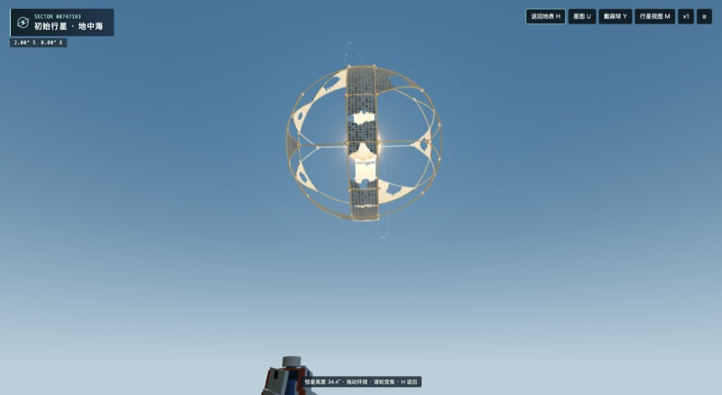](./docs/surface-sky.png)

从伊卡洛斯身后抬头，可以透过尚未合拢的球壳看到日面。

双击 [离线游戏](./index.html) 后选择「开始着陆」。使用支持 WebGL 2 的桌面浏览器。三维模型、着色器、界面与玩法模拟均在本地运行。项目以公开游戏资料和实机画面为参照，保留独立的教学档与标准进度。

第一次着陆可按 **V** 寻找铁矿和铜矿，点击采集，再按 **E** 制作磁线圈，按 **T** 研究电磁学。用风力供电，给采矿机接出传送带，再用分拣器把原矿送入冶炼炉。**B** 打开建造菜单，**F** 打开背包，**P** 查看生产统计，**Esc** 返回。

标题页的「教学工厂」可体验自动冶炼、分流与集装、喷涂、机甲配送、蓝图建设、石油精炼、星际货运、跨星球输电、巨星采集、海岸整地、黑雾地面防守、黑雾样本研究、行星护盾与中继降落、异星地质勘查、矿物连续研究和宇宙矩阵交付。每个教学场景使用独立存档。恒星工程沙盒中按 **Y** 查看和编辑戴森球，按 **U** 打开星图选择其他天体。**M** 切换行星视图，**J** 打开地形笔刷。

进度会自动保存在当前浏览器。系统菜单可保存、导出、导入和选择画质。节能档限制为 30 FPS 和 90 万物理像素。生产统计、资源余额和壳层施工由固定步长模拟结算。离开标签页后暂停绘制与模拟。

玩法收集、可验证的产线、参考图和待完成部分见 [玩法对照](./docs/玩法对照.md)。

## 实机截图

这些截图都来自网页版。点开原图可以看清矿脉、传送带的上下层和设备面板上的读数。

[星球地表](#星球地表) · [地表工厂](#地表工厂) · [地表巡检与防守](#地表巡检与防守) · [跨行星工业](#跨行星工业) · [航行与戴森工程](#航行与戴森工程)

### 星球地表

在「教学工厂」选择「海岸整地与填海」「异星地质勘查」或「跨星球输电」，可以走到下面这些岸线上，亲手改造地形、接通矿场。

<table>
  <tr>
    <td width="50%" valign="top">
      <a href="./docs/coast.png">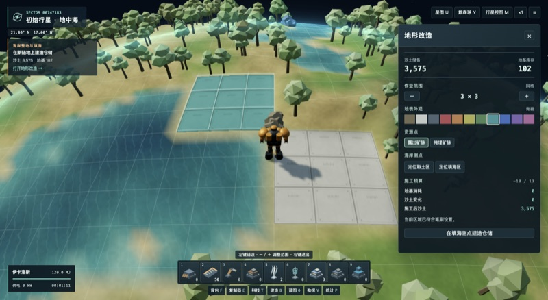</a><br>
      <strong>海岸整地</strong><br>在山坡取土，把沙土运到浅海铺地基，再在新岸线上建仓库。
    </td>
    <td width="50%" valign="top">
      <a href="./docs/seabed.png">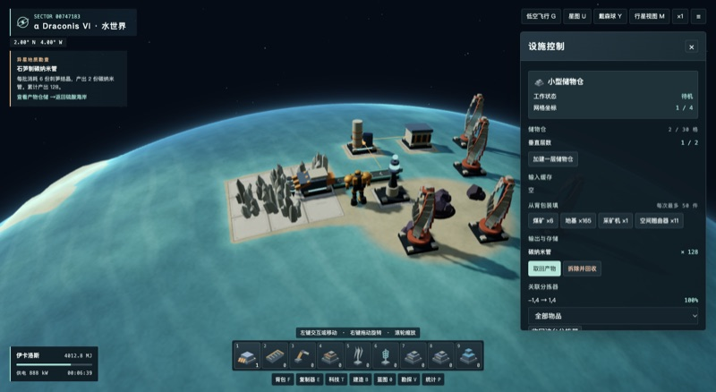</a><br>
      <strong>水世界的刺笋矿</strong><br>铺开海床的九格地基，露出刺笋矿脉。化工厂把结晶制成碳纳米管，图中已入仓 128 份。
    </td>
  </tr>
  <tr>
    <td width="50%" valign="top">
      <a href="./docs/acid-coast.png">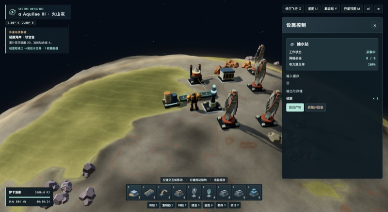</a><br>
      <strong>硫酸海岸</strong><br>把抽水站的进液口朝向硫酸海，泵出的硫酸经传送带送进钛合金产线。
    </td>
    <td width="50%" valign="top">
      <a href="./docs/power-exchange.png">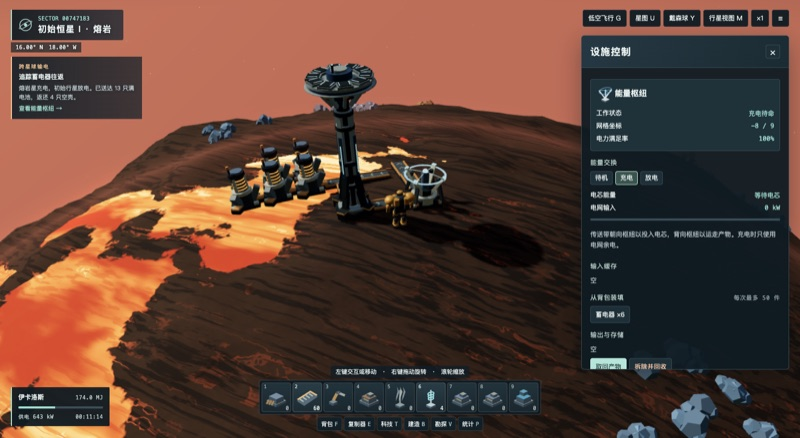</a><br>
      <strong>熔岩星的地热电站</strong><br>沿熔岩岸线建地热电站，给蓄电器充电，再交给运输船送往另一颗行星。
    </td>
  </tr>
</table>

### 地表工厂

<table>
  <tr>
    <td width="50%" valign="top">
      <a href="./docs/elevated-belts.png">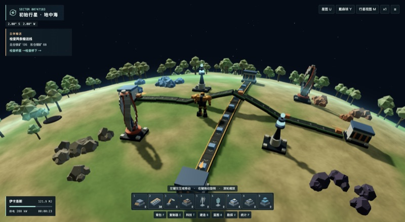</a><br>
      <strong>两条传送带立体交叉</strong><br>铜矿上桥，铁矿从桥下通过。截图时北仓收到 135 份铁矿，东仓收到 68 份铜矿。
    </td>
    <td width="50%" valign="top">
      <a href="./docs/splitter.png">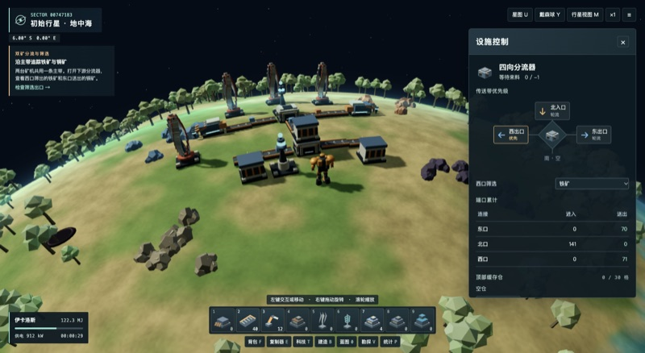</a><br>
      <strong>双矿分流入仓</strong><br>让两种矿共用一条主带，在分流器出口筛选铁矿，把铜矿送进另一座仓库。
    </td>
  </tr>
  <tr>
    <td width="50%" valign="top">
      <a href="./docs/piling.png">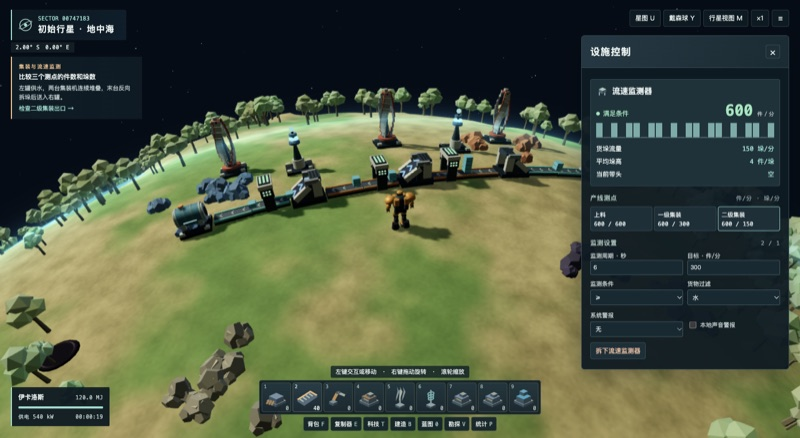</a><br>
      <strong>四层集装</strong><br>两台集装机连续叠货。对照三个测点，每分钟都是 600 件，货垛从 600 垛降到 300 垛，再降到 150 垛。
    </td>
    <td width="50%" valign="top">
      <a href="./docs/coating.png">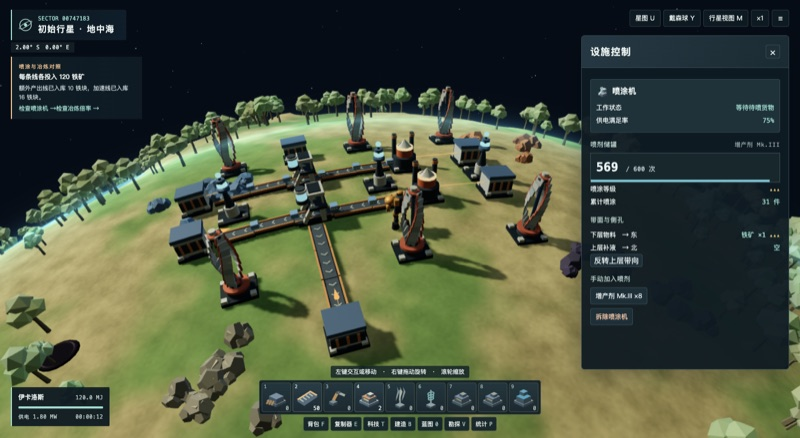</a><br>
      <strong>喷涂与冶炼对照</strong><br>给两条线各投 120 份铁矿，一台炉选额外产出，一台选生产加速，再比较入仓的铁块。
    </td>
  </tr>
  <tr>
    <td width="50%" valign="top">
      <a href="./docs/advanced-mining.png"></a><br>
      <strong>大型采矿机</strong><br>采矿机覆盖铁矿脉，需求塔派运输机来取矿。
    </td>
    <td width="50%" valign="top">
      <a href="./docs/refit.png"></a><br>
      <strong>产线原位换装</strong><br>换成集装分拣器和蓝带后，测点读到每分钟 7,200 件铁块。
    </td>
  </tr>
  <tr>
    <td width="50%" valign="top">
      <a href="./docs/blueprint.png"></a><br>
      <strong>蓝图施工</strong><br>框选冶炼线、旋转蓝图，再让建设机逐件送来设备。
    </td>
    <td width="50%" valign="top">
      <a href="./docs/production.png"></a><br>
      <strong>生产统计</strong><br>按时间范围对照铁矿消耗和铁块产量。
    </td>
  </tr>
</table>

### 地表巡检与防守

<table>
  <tr>
    <td width="50%" valign="top">
      <a href="./docs/distribution.png">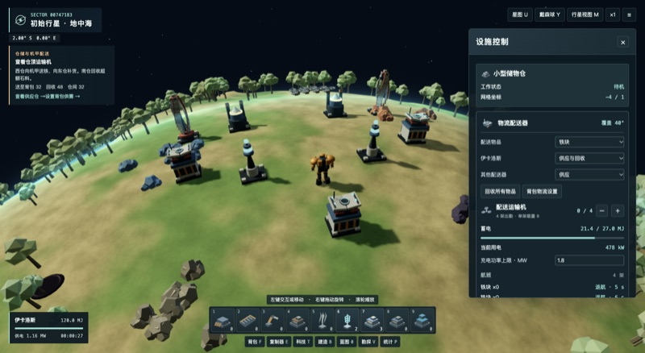</a><br>
      <strong>机甲补货</strong><br>给背包设定供需数量。图中配送运输机已向机甲送去 32 件物品，回收了 48 件。
    </td>
    <td width="50%" valign="top">
      <a href="./docs/beacon.png">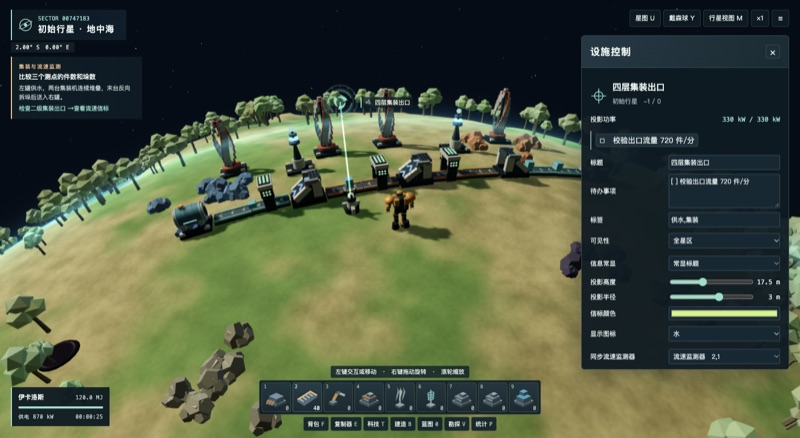</a><br>
      <strong>给产线立信标</strong><br>在四层集装出口挂上流速测点，从远处就能找到这段带路，打开信标可查看待办事项。
    </td>
  </tr>
  <tr>
    <td width="50%" valign="top">
      <a href="./docs/ground-defense.png">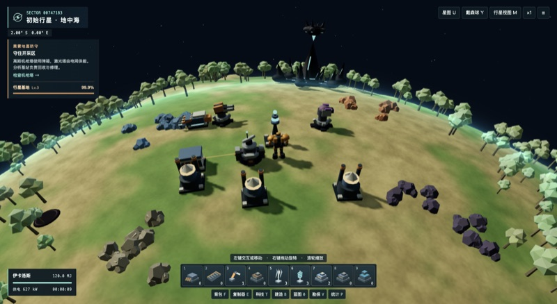</a><br>
      <strong>守住采矿区</strong><br>矿机旁的防御塔守住产线，战场分析基站负责回收和修理。地平线上是黑雾行星基地。
    </td>
    <td width="50%" valign="top">
      <a href="./docs/signal-outpost.png">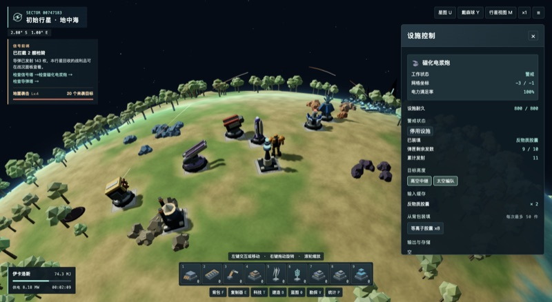</a><br>
      <strong>信号前哨</strong><br>在地面打开设施面板，查看远处目标和警戒状态。图中的前哨已拦截两艘枪骑。
    </td>
  </tr>
</table>

### 跨行星工业

<table>
  <tr>
    <td width="50%" valign="top">
      <a href="./docs/refinery.png"></a><br>
      <strong>精炼与分馏</strong><br>原油精炼产生氢，分馏环让未转化的氢继续循环。
    </td>
    <td width="50%" valign="top">
      <a href="./docs/logistics.png">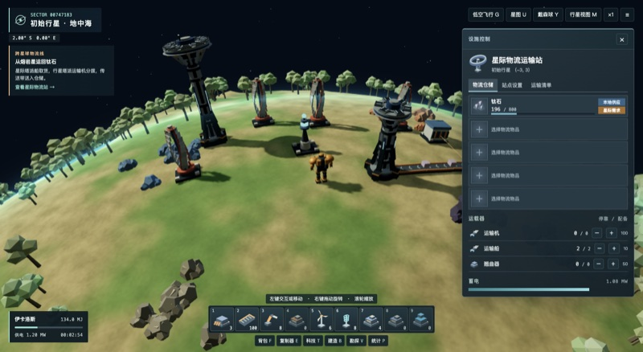</a><br>
      <strong>跨星球物流</strong><br>运输船运回钛石，再由本地运输机分拨。
    </td>
  </tr>
  <tr>
    <td width="50%" valign="top">
      <a href="./docs/orbital-collectors.png">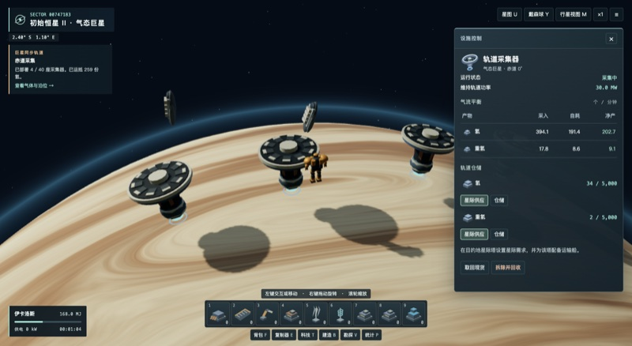</a><br>
      <strong>巨星轨道采集</strong><br>在巨星赤道布置采集器，等待运输船来取货。
    </td>
    <td width="50%" valign="top">
      <a href="./docs/planetary-shield.png">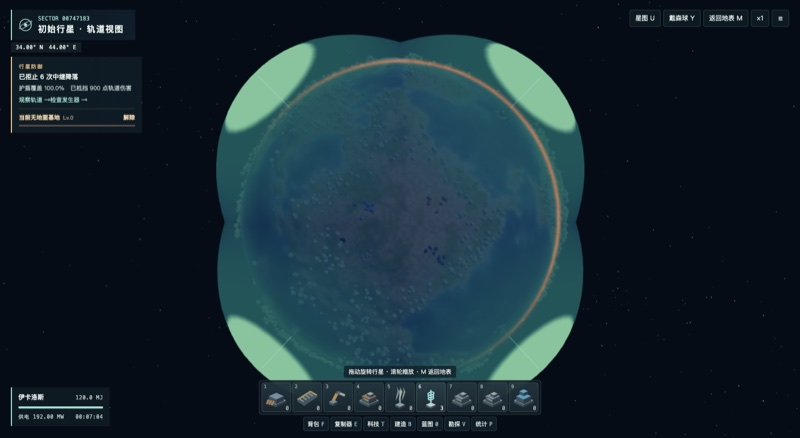</a><br>
      <strong>行星护盾</strong><br>从轨道看发生器的覆盖范围和已抵挡的轨道伤害。
    </td>
  </tr>
</table>

### 航行与戴森工程

<table>
  <tr>
    <td width="50%" valign="top">
      <a href="./docs/cluster.png">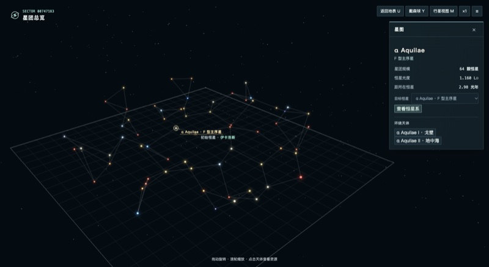</a><br>
      <strong>星团航线</strong><br>在星图上选择目标恒星，查看跨星距离。
    </td>
    <td width="50%" valign="top">
      <a href="./docs/sail-flight.png">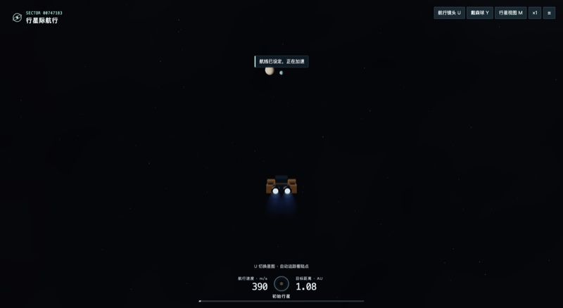</a><br>
      <strong>机甲航行</strong><br>跟随伊卡洛斯飞往目标行星。
    </td>
  </tr>
  <tr>
    <td width="50%" valign="top">
      <a href="./docs/layer-orbit.png"></a><br>
      <strong>壳层设计</strong><br>在编辑器中查看 9 km 和 14 km 两层轨道。
    </td>
    <td width="50%" valign="top">
      <a href="./docs/stellar-yard.png"></a><br>
      <strong>恒星工地</strong><br>绕到在建壳层旁，看建设中的节点、框架和帆面如何遮住恒星。
    </td>
  </tr>
</table>

## 许可与来源

本项目的原创代码使用 [MIT 许可证](./LICENSE)。离线入口包含 [Three.js](https://github.com/mrdoob/three.js) 和源自 [FactorioLab](https://github.com/factoriolab/factoriolab/tree/50d8e977256344ab0405e32910c26a5fe09c404a/public/data/dsp) 的数值目录与译名，各自保留[引擎许可](./licenses/Three.txt)与[数据许可](./licenses/FactorioLab.txt)。仓库中的实机截图摄自本网页。《戴森球计划》的名称、商标与原作素材权利属于各自权利人。[原作主页](https://store.steampowered.com/app/1366540/Dyson_Sphere_Program/)

## 开发与验证

安装 Node.js 22.12 或更新版本后，在项目根目录运行下面的命令。安装依赖后可离线构建。

```sh
npm ci
npm test
npm run build
```

打包会重新生成 [离线入口](./index.html)，包含 Three.js、数值数据、样式与脚本。
